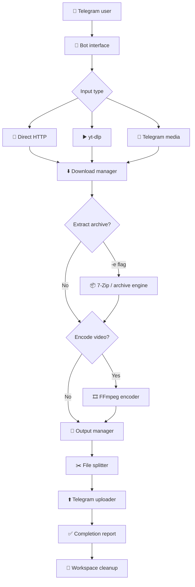

<div align="center">


<br/>

**Mirror, extract, encode and deliver media straight from Telegram.**

<br/>


<br/>

[Features](#-features) ·
[Workflow](#-how-it-works) ·
[Commands](#-commands) ·
[Settings Panel](#%EF%B8%8F-settings-panel) ·
[Heroku](#%EF%B8%8F-deploy-on-heroku) ·
[Install](#-installation-local--vps--termux) ·
[Config](#%EF%B8%8F-configuration) ·
[Security](#-security)

<br/>

[](https://heroku.com/deploy?template=https://github.com/RAHAT11790/RS_ENCODER_MIRROR_BOT)

</div>

---

## 📖 Overview

**RS ENCODER MIRROR BOT** is a self-hosted Telegram bot that puts your whole media pipeline behind one chat interface. Send a link or a file, and the bot downloads it, optionally extracts or encodes it, builds a thumbnail, splits oversized output and uploads the result back to Telegram. All of it runs asynchronously, with a live progress board.

| | |
|---|---|
| 📥 **Get** | Direct links, Telegram media, YouTube, HLS / M3U8 and any site yt-dlp supports |
| 🎬 **Process** | Archive extraction, H.264 / H.265 encoding, resolution scaling |
| 📤 **Deliver** | Auto thumbnails, file splitting, parallel uploads, automatic cleanup |

---

## ✨ Features

<table>
<tr>
<td width="50%" valign="top">

### 📥 Mirror Engine

- Direct HTTP / HTTPS downloads
- Telegram media downloads
- Several URLs in a single task
- yt-dlp integration (YouTube, HLS / M3U8 and more)
- Custom output filenames
- Optional download headers
- Cookie file support for restricted sources

</td>
<td width="50%" valign="top">

### 🎬 Video Encoder

- FFmpeg based, **H.264** and **H.265**
- CRF quality control
- Presets from `ultrafast` to `slow`
- Resolutions from 360p to 4K, or original
- Audio: AAC, AC3, Opus or copy
- MP4, MKV and AVI containers
- Per-user saved encoder settings

</td>
</tr>
<tr>
<td width="50%" valign="top">

### 📦 Archive Processor

- ZIP, TAR, GZIP, BZIP2 and XZ
- RAR and 7Z through a 7-Zip compatible tool
- Password-protected archives
- Interactive password prompt
- Safe extraction path checks
- Opt-in only, via the `-e` flag

</td>
<td width="50%" valign="top">

### 🖼️ Thumbnail System

- Automatic video thumbnails
- TMDb backdrop and logo composition
- FFmpeg frame sheets (for example `2x2`)
- Personal custom thumbnails
- Configurable layouts

</td>
</tr>
<tr>
<td width="50%" valign="top">

### ⚡ Task System

- Fully asynchronous pipelines
- Configurable concurrency for tasks, uploads and FFmpeg
- Live progress board
- Task cancellation
- Free-disk-space protection
- Automatic workspace cleanup

</td>
<td width="50%" valign="top">

### 🛡️ Access Control

- Owner-only administration
- Sudo users and authorized chats
- Ban and unban users or chats
- Premium user management
- Restart and log retrieval
- Telegram command menu sync

</td>
</tr>
</table>

---

## 🔄 How It Works



<details>
<summary><b>Step by step</b></summary>

1. A user sends a media URL or a Telegram media message.
2. The bot identifies the input source.
3. The matching download engine fetches the file.
4. Archive extraction runs if `-e` was given.
5. FFmpeg encoding runs if requested.
6. Output files are collected and validated.
7. Files above the split limit are cut into numbered parts.
8. Everything is uploaded to Telegram.
9. The bot reports completion or failure.
10. Temporary task files are removed.

</details>

---

## 🎞️ Encoder Reference

<table>
<tr>
<td valign="top" width="50%">

**Resolution presets**

| Preset | Output height |
|:--|:--|
| `360p` | 360 |
| `480p` | 480 |
| `560p` / `576p` | 576 |
| `720p` | 720 |
| `1080p` | 1080 |
| `1440p` / `2k` | 1440 |
| `2160p` / `4k` | 2160 |
| `OG` | Original source height |

</td>
<td valign="top" width="50%">

**Codecs and options**

| Option | Values |
|:--|:--|
| Video codec | H.264 (`libx264`), H.265 (`libx265`) |
| Presets | `ultrafast` `superfast` `veryfast` `fast` `medium` `slow` |
| Audio | `aac` `copy` `ac3` `opus` |
| Containers | `mp4` `mkv` `avi` |

</td>
</tr>
</table>

**Default encoder profile**

| Setting | Default | Setting | Default |
|:--|:--|:--|:--|
| Codec | H.264 | Audio | AAC |
| Preset | `veryfast` | Audio bitrate | 128 kbps |
| CRF | 26 | Container | MP4 |
| Resolution | Original | Faststart | Enabled |
| Subtitles | Copy | | |

Per-user settings are stored in `data/encoder.json`.

---

## 💬 Commands

### 📥 Download and general

| Command | Description |
|:--|:--|
| `/start` | Open the main interface |
| `/help` | Show the command guide |
| `/leech` · `/l` | Download a direct URL or replied media |
| `/ytdlleech` · `/yl` | Download through yt-dlp (also `/ytleech`, `/ytdl`) |
| `/status` | Live progress board |
| `/cancel` | Cancel a running task |
| `/stats` | Bot and server statistics |
| `/ping` | Check latency |
| `/cookies` | Show where to place the yt-dlp cookie file |
| `/setthumb` · `/delthumb` | Set or remove your personal thumbnail |

### 🎬 Encoder

| Command | Description |
|:--|:--|
| `/encode` | Encode with your saved settings |
| `/360p` `/480p` `/560p` `/576p` | Encode at that height |
| `/720p` `/1080p` `/1440p` `/2k` `/2160p` `/4k` | Encode at that height |
| `/264h` · `/265h` | Set the codec to H.264 or H.265 |
| `/settings` | Open the **interactive settings panel** (every option is a button) |
| `/reset` | Reset encoder settings to defaults |

### 👑 Owner and admin

| Command | Description |
|:--|:--|
| `/authorize` · `/unauthorize` | Grant or revoke access for a user or chat |
| `/ban` · `/unban` | Block or unblock a user or chat |
| `/premium` | Add, remove or list premium users |
| `/addpremium` · `/removepremium` | Shortcuts for premium management |
| `/restart` | Restart the bot |
| `/log` | Download the log file |
| `/synccommands` | Resync the Telegram command menu |

### 🚩 Flags for `/leech` and `/ytdlleech`

| Flag | Meaning |
|:--|:--|
| `-e` | Extract archives (off by default, archives are delivered as is) |
| `-p <password>` | Password for protected archives |
| `-n <name>` | Custom output filename |
| `-d` | Upload as a document |
| `-q <height>` | Video quality for yt-dlp (for example `720`) |
| `-a` | Audio only (yt-dlp) |

### 🚩 Flags for `/encode`

| Flag | Meaning |
|:--|:--|
| `-r <res>` | Resolution, for example `720p` |
| `-c <codec>` | `h264` or `h265` |
| `-crf <0-51>` | Quality, lower means better quality and a bigger file |
| `-preset <name>` | Speed preset |
| `-a <codec>` | Audio codec |

---

## 🚀 Usage Examples

```text
# Download a direct link
/leech https://example.com/video.mp4

# Short form
/l https://example.com/video.mp4

# Download and extract an archive
/l https://example.com/archive.zip -e

# Extract a password-protected archive
/l https://example.com/archive.zip -e -p mypassword

# yt-dlp download
/yl https://youtu.be/VIDEO_ID

# Pick a quality
/yl https://youtu.be/VIDEO_ID -q 720

# Audio only
/yl https://youtu.be/VIDEO_ID -a

# Custom filename
/yl https://youtu.be/VIDEO_ID -n My_Video
```

**Encoding.** Reply to a Telegram video with any of these:

```text
/encode
/encode -r 720p -c h265 -crf 22 -preset fast
/720p
/265h
```

---

## 🎛️ Settings Panel

Send `/settings` and tap buttons instead of typing flags. Every tap is saved instantly for your user.

| Button | Options |
|:--|:--|
| 🎞 **Codec** | H.264, H.265 |
| 📐 **Resolution** | Original, 360p, 480p, 576p, 720p, 1080p, 1440p, 4K |
| ⚡ **Preset** | `ultrafast` to `slow` |
| 🎚 **CRF** | Quick values 18 to 32, plus ➖ / ➕ for fine steps |
| 🔊 **Audio** | AAC, Copy, AC3, Opus, bitrate 64k to 256k |
| 📦 **Format** | MP4, MKV, AVI |
| 💬 **Subs** | Keep or remove subtitle tracks |
| 🎨 **Tune** | None, Film, Animation, Grain |
| 🏷 🚀 **Toggles** | Watermark, Faststart |
| ♻️ **Reset** · ✖️ **Close** | Restore defaults, close the panel |

The panel belongs to the user who opened it. Other people in a group cannot change your settings, and the card stays on screen for 10 minutes. When you are done, reply to a video with `/encode`.

---

## ☁️ Deploy on Heroku

The repository ships a `Dockerfile`, `heroku.yml` and `app.json`, so Heroku builds a container where **all system packages (FFmpeg, 7-Zip, bsdtar) are installed at build time**. Nothing is downloaded when the dyno starts.

### Option A: one click

1. Press the **Deploy to Heroku** button at the top of this page.
2. Fill in `BOT_TOKEN`, `TELEGRAM_API`, `TELEGRAM_HASH` and `OWNER_ID`.
3. Deploy, then open **Resources** and make sure the `web` dyno is on.

### Option B: Heroku CLI

```bash
heroku login
heroku create your-app-name --stack container

heroku config:set \
  BOT_TOKEN="123456:ABC..." \
  TELEGRAM_API=123456 \
  TELEGRAM_HASH="your_api_hash" \
  OWNER_ID=123456789 \
  AUTHORIZED_CHATS="-1001234567890" \
  TIMEZONE="Asia/Dhaka"

git push heroku main
heroku ps:scale web=1
heroku logs --tail
```

If your branch is called `master`, push with `git push heroku master`.

### How it behaves on Heroku

- **Web dyno.** The bot opens a small status page on `$PORT` *before* it logs in to Telegram, so Heroku never reports a boot timeout. Open your app URL to see uptime, memory, free disk and which tools were found. `/health` returns the same data as JSON.
- **Config Vars instead of `config.py`.** Every setting in the [Configuration](#%EF%B8%8F-configuration) tables works as a Config Var with the same name. Never upload `config.py`.
- **YouTube cookies.** Paste the content of your Netscape `cookies.txt` into a Config Var named `YT_COOKIES`. It is written to a file on every start.
- **Defaults for small dynos.** `MAX_CONCURRENT_TASKS=1`, `MAX_PARALLEL_FFMPEG=1`, `MIN_FREE_DISK_GB=1`. Raise them only on bigger dynos.

### Good to know

| Topic | What to expect |
|:--|:--|
| **Storage is temporary** | Heroku wipes the disk on every restart and at least once every 24 hours. Downloads in progress are lost, and so are the saved encoder settings, thumbnails and authorized or premium lists stored under `data/`. Put permanent admins in `OWNER_ID`, `SUDO_USERS` and `AUTHORIZED_CHATS` Config Vars. |
| **Dyno size** | Encoding needs RAM and CPU. A `basic` dyno has 512 MB, which is fine for downloads and light encodes. For H.265 or 1080p and above use `standard-2x` or larger. If logs show `R14` or `R15`, the dyno ran out of memory. |
| **Eco dynos sleep** | A web dyno on the Eco plan sleeps after 30 minutes without web traffic and the bot goes offline. Use Basic or higher, or ping `/health` every few minutes from an uptime monitor. |
| **Restarts** | A restart (deploy, daily cycle, `/restart`) logs the bot in to Telegram again. Avoid rapid restart loops, because Telegram answers those with a flood wait. |

---

## 🧰 Installation (local / VPS / Termux)

### Requirements

- Python **3.10 to 3.13** (3.14 is not supported yet)
- Telegram **Bot Token** (from [@BotFather](https://t.me/BotFather))
- Telegram **API ID** and **API Hash** (from [my.telegram.org](https://my.telegram.org))
- FFmpeg and FFprobe
- A 7-Zip compatible tool (only for RAR / 7Z)
- Enough free disk space

> `main.py` installs missing Python packages by itself. For FFmpeg, yt-dlp and 7-Zip without root access (Linux, Termux), run `bash install.sh`: it downloads portable builds into `./bin`.

### 1. Clone

```bash
git clone https://github.com/rahadcodes228/RS_ENCODER_MIRROR_BOT.git
cd RS_ENCODER_MIRROR_BOT
```

### 2. Create a virtual environment

<details open>
<summary><b>Linux · VPS · Termux</b></summary>

```bash
python -m venv .venv
source .venv/bin/activate
```

</details>

<details>
<summary><b>Windows</b></summary>

```bat
py -3.13 -m venv .venv
.venv\Scripts\activate
```

You can also just double-click `start.bat`, which creates the environment and starts the bot.

</details>

### 3. Install dependencies

```bash
python -m pip install --upgrade pip
pip install -r requirements.txt
```

### 4. Configure

```bash
cp config.example.py config.py
```

Open `config.py` and fill in your own values:

```python
BOT_TOKEN     = "YOUR_BOT_TOKEN"
TELEGRAM_API  = 123456            # your API ID
TELEGRAM_HASH = "YOUR_API_HASH"
OWNER_ID      = 123456789         # your numeric Telegram user ID
```

Optional: add `TMDB_API_KEY` for automatic artwork.

### 5. Run

```bash
python main.py
```

`main.py` checks the interpreter, installs missing packages, starts the bot in a supervised child process and restarts it after a crash. It gives up after 8 quick crashes in a row.

---

## ⚙️ Configuration

Everything lives in `config.py`. Any value can also be set as an **environment variable** with the same name.

<details>
<summary><b>Credentials and access</b></summary>

| Variable | Purpose |
|:--|:--|
| `BOT_TOKEN` | Telegram bot token |
| `TELEGRAM_API` | Telegram API ID |
| `TELEGRAM_HASH` | Telegram API hash |
| `OWNER_ID` | Owner's numeric Telegram ID |
| `SUDO_USERS` | Extra admin IDs (space or comma separated) |
| `AUTHORIZED_CHATS` | Users and chats allowed to use the bot |

</details>

<details>
<summary><b>Speed and resources</b></summary>

| Variable | Default | Purpose |
|:--|:--|:--|
| `DOWNLOAD_DIR` | `downloads` | Working directory |
| `MAX_CONCURRENT_TASKS` | `2` | Pipelines running at once |
| `MAX_CONCURRENT_UPLOADS` | `2` | Simultaneous uploads (1 to 4) |
| `MAX_PARALLEL_FFMPEG` | `2` | Parallel FFmpeg / FFprobe processes |
| `DOWNLOAD_CONNECTIONS` | `8` | Connections per direct download (1 to 8) |
| `MIN_FREE_DISK_GB` | `2.0` | New tasks are refused below this |
| `MAX_FILE_SIZE_GB` | `0` | Maximum output size, `0` means unlimited |
| `SPLIT_SIZE` | `2097152000` | Split threshold in bytes |

</details>

<details>
<summary><b>Delivery and thumbnails</b></summary>

| Variable | Default | Purpose |
|:--|:--|:--|
| `LEECH_TO_PM` | `True` | Deliver group-requested files privately |
| `AS_DOCUMENT` | `False` | Upload as documents instead of videos |
| `AUTO_THUMBNAIL` | `True` | Generate thumbnails automatically |
| `THUMBNAIL_LAYOUT` | `2x2` | Frame sheet layout, empty for a single frame |
| `TMDB_API_KEY` | | TMDb API key |
| `TMDB_ACCESS_TOKEN` | | TMDb access token |

</details>

<details>
<summary><b>Downloads and interface</b></summary>

| Variable | Default | Purpose |
|:--|:--|:--|
| `YT_COOKIES_FILE` | `cookies.txt` | yt-dlp cookie file (Netscape format) |
| `TG_PROXY` | | Outbound proxy, for example `socks5://127.0.0.1:1080` |
| `ALLOW_INSECURE_SSL` | `False` | Only for broken or self-signed servers |
| `STATUS_UPDATE_INTERVAL` | `10` | Seconds between progress updates |
| `SET_COMMANDS` | `True` | Refresh the command menu on start |
| `AUTO_DELETE_MESSAGES` | `True` | Delete bot cards automatically |
| `START_MESSAGE_TTL` | `30` | `/start` card lifetime (seconds) |
| `INFO_MESSAGE_TTL` | `30` | Hint card lifetime (seconds) |
| `RESULT_MESSAGE_TTL` | `60` | Result card lifetime (seconds) |
| `CLEAN_USER_MESSAGES` | `True` | Delete the command message when the task ends |

</details>

---

## 🗂️ Project Structure

```text
RS_ENCODER_MIRROR_BOT/
├── main.py                 # Launcher: setup, supervision, auto-restart
├── config.example.py       # Safe config template (copy to config.py)
├── requirements.txt
├── Dockerfile              # Heroku / Docker image with FFmpeg and 7-Zip preinstalled
├── heroku.yml              # Tells Heroku to build the Dockerfile
├── app.json                # Deploy-button definition and Config Var list
├── Procfile                # Web process (used by non-container hosts)
├── start.bat               # One-click Windows launcher
├── install.sh              # Rootless installer for ffmpeg, yt-dlp and 7-Zip (into ./bin)
├── rs_setup.py             # Pre-flight: checks and installs Python packages
├── rsbin.py                # Finds tools in ./bin first, then in PATH
├── bin_bootstrap.py        # Puts ./bin at the front of PATH at runtime
│
├── encoder/                # FFmpeg encoding engine
│   ├── engine.py
│   ├── presets.py
│   ├── progress.py
│   ├── settings.py
│   └── assets/             # font.ttf, watermark.ass
│
└── lite/                   # Bot core
    ├── bot.py              # Handlers, commands, UI
    ├── encoder_commands.py # /encode, resolution commands and the /settings panel
    ├── heroku.py           # Status page on $PORT, YT_COOKIES support
    ├── pipeline.py         # Download → extract → encode → upload
    ├── http_dl.py          # Multi-connection direct downloader
    ├── ytdl.py             # yt-dlp integration
    ├── archive.py          # Archive extraction
    ├── media.py            # ffprobe, thumbnails, transcoding
    ├── tmdb.py             # TMDb artwork
    ├── uploader.py         # Telegram upload and splitting
    ├── task.py             # Task state and progress
    ├── store.py            # Small local JSON store (authorized IDs, thumbnails)
    ├── fmt.py              # Message formatting
    ├── buttons.py          # Inline keyboards
    ├── engines.py          # Engine labels and versions for the status card
    └── config.py           # Defaults < config.py < environment variables
```

---

## 🧱 Tech Stack

| Technology | Role |
|:--|:--|
| **Python** | Core application |
| **wzgram** | Telegram client framework |
| **asyncio** | Asynchronous execution |
| **aiohttp** / **aiofiles** | Networking and file I/O |
| **yt-dlp** | Website media extraction |
| **FFmpeg** / **FFprobe** | Encoding and media analysis |
| **Pillow** | Thumbnail processing |
| **py7zr** | Archive handling |
| **psutil** | System monitoring |

---

## 🔒 Security

> [!WARNING]
> Never commit real credentials. A leaked bot token lets anyone control your bot.

- Keep `config.py` and `cookies.txt` out of Git (the included `.gitignore` already does this). On Heroku, keep secrets in Config Vars only.
- Keep TMDb and other API keys private.
- Restrict owner and sudo access, and use `AUTHORIZED_CHATS`.
- Protect your server and download directory.
- Update Python packages and external binaries regularly.
- If a token was ever exposed, revoke it in [@BotFather](https://t.me/BotFather) and generate a new one.

---

## 📝 Notes

- Designed for **self-hosted** use.
- yt-dlp support depends on each website and its available formats.
- RAR and 7Z need an installed 7-Zip compatible binary.
- H.265 is slower than H.264, and 4K needs a lot of CPU and storage.
- Telegram upload limits depend on the account and the bot API in use.
- Respect copyright, website terms and the law when downloading or sharing media.

---

## 📄 License

No license has been chosen yet. Add a `LICENSE` file to state how others may use, modify and distribute this project.

---

<div align="center">

**RS ENCODER MIRROR BOT**

*Built for powerful media automation through Telegram.*

[](https://github.com/rahadcodes228/RS_ENCODER_MIRROR_BOT)

<sub>Download · Mirror · Encode · Deliver</sub>

</div>
